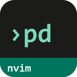
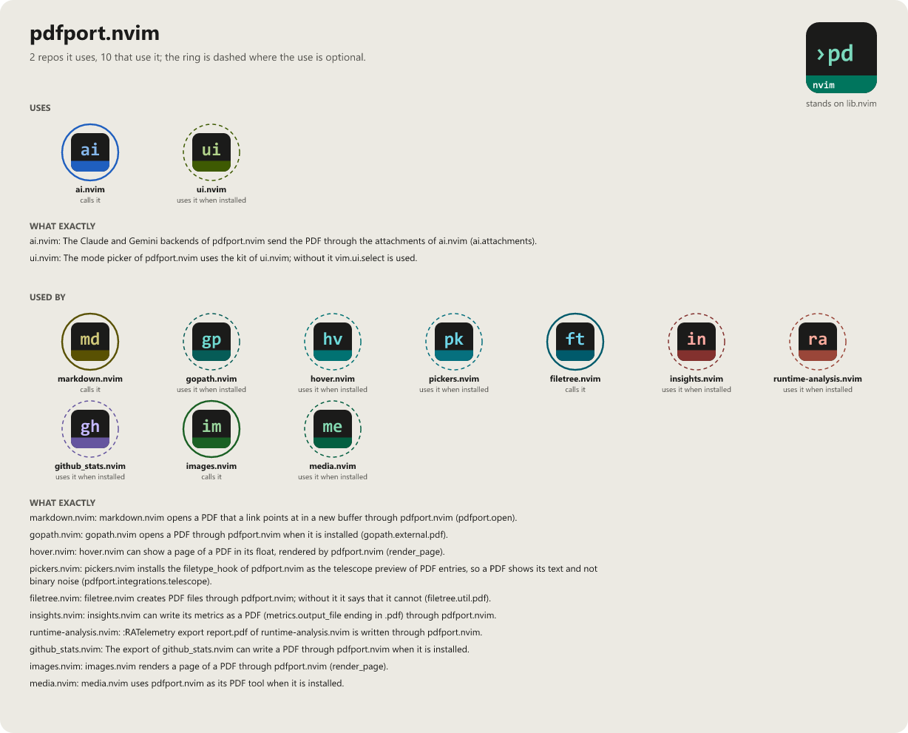

> **Beta stage — active development.** This repository is past its first shape and in
> active use, but the surface is not frozen: breaking changes are still possible. Pin a
> commit or tag if you depend on it.

# pdfport.nvim

```
           _  __                  _                _
 _ __   __| |/ _|_ __   ___  _ __| |_   _ ____   _(_)_ __ ___
| '_ \ / _` | |_| '_ \ / _ \| '__| __| | '_ \ \ / / | '_ ` _ \
| |_) | (_| |  _| |_) | (_) | |  | |_ _| | | \ V /| | | | | | |
| .__/ \__,_|_| | .__/ \___/|_|   \__(_)_| |_|\_/ |_|_| |_| |_|
|_|             |_|
```

[](LICENSE)
[](https://neovim.io)
[](https://www.lua.org)

[](https://github.com/WKDSteve/pdfport.nvim/actions/workflows/ci.yml)
[](https://wkdsteve.github.io/wkd/p/pdfport/)

> Part of the [wkd](https://wkdsteve.github.io/wkd/) family — see this plugin's [page](https://wkdsteve.github.io/wkd/p/pdfport/) on the site.

PDFs in Neovim, in both directions: reading them and writing them. Reading
means extracting and displaying a PDF's content through a pluggable backend;
writing means creating one — from an image, Markdown, text, HTML or an Office
file, or merging several — through a pluggable producer. Both sides degrade to
a clear message rather than an error when a tool is not there.

---

## Around it

> **[filetree.nvim](https://github.com/WKDSteve/filetree.nvim)** — the file
> tree from the same collection. It does not need an adapter here: it calls
> `pdfport.pick_open()` directly, which is why hitting a PDF in it asks exactly
> the question `:PdfPort` asks.
>
> **[hover.nvim](https://github.com/WKDSteve/hover.nvim)** — previews a PDF
> page, and a `.docx`, in a float. Both go through `render_page()`; the `.docx`
> path converts first, then rasterizes page one.
>
> **[images.nvim](https://github.com/WKDSteve/images.nvim)** — draws that
> same rasterized page in a picker's preview window.
>
> **[markdown.nvim](https://github.com/WKDSteve/markdown.nvim)** — sends
> `:Markdown export pdf` here, and follows a `.pdf` link into a buffer instead
> of the system reader.
>
> **[mdview.nvim](https://github.com/WKDSteve/mdview.nvim)** — previews the
> Markdown the AI and layout backends extract.
>
> **[ai.nvim](https://github.com/WKDSteve/ai.nvim)** — carries the HTTP
> requests for the `claude`, `gemini` and `ollama` extraction backends, so
> none of them has to hand-roll its own curl/provider path. Without it those
> three report themselves unavailable; the other five extraction backends are
> untouched.
>
> All of the above are soft: without them everything else works unchanged.
> [lib.nvim](https://github.com/WKDSteve/lib.nvim) is the one real plugin
> dependency — see [Requirements](docs/requirements.md).

---

## Documentation

Start at [docs/README.md](docs/README.md), which says what is where and which
question each page answers.

### The Basics

- [Requirements](docs/requirements.md) — this plugin's job is to drive external tools, so this is the interesting part.
- [Installation](docs/installation.md) — a spec per plugin manager.
- [Quickstart](docs/quickstart.md) — the first thing to run after installing.

### Configuration

- [What you get with the defaults](docs/what-you-get.md) — the full command/API surface at a glance.
- [All options](docs/configuration.md) — every `setup()` option, and the extraction backend table.
- [Command reference](docs/commands.md) — every command, its arguments, and the Lua API.
- [Bindings cheatsheet](docs/BINDINGS.md) — every keymap, user command and autocommand this plugin registers.

### The Rest

- [Features](docs/FEATURES/README.md) — one page per area: [the core](docs/FEATURES/CORE.md), [rendering](docs/FEATURES/RENDERING.md), [the backends it reads with](docs/FEATURES/BACKENDS.md), [the producers it writes with](docs/FEATURES/PRODUCERS.md), [the integrations](docs/FEATURES/INTEGRATIONS.md).
- [Integrations](docs/integrations.md) — which other plugins reach this one and how, starting with the file trees.
- [Workflow](docs/WORKFLOW.md) — how the pieces combine once several backends and producers are available at once, and the gotchas worth knowing before they cost a debugging session.
- [Health check](docs/health.md) — the ten `:checkhealth pdfport` sections, and which findings are actually problems.
- [Contributing](docs/CONTRIBUTING.md) — ground rules, project layout, and how to add a backend or a producer.
- [Feedback](https://github.com/WKDSteve/pdfport.nvim/issues) — bugs, feature requests and usage questions; broader discussion in [Discussions](https://github.com/WKDSteve/pdfport.nvim/discussions).

`:help pdfport` is the same reference inside the editor.

---

## License

[](LICENSE)

pdfport.nvim is released under the [MIT License](https://opensource.org/licenses/MIT).

<!-- connections:begin (written by the app-icons tool of the workshop; change integrations.json there, not this block) -->
## Connections



**Uses**

- [ai.nvim](https://github.com/WKDSteve/ai.nvim): The Claude and Gemini backends of pdfport.nvim send the PDF through the attachments of ai.nvim (`ai.attachments`). ([picture](assets/graphs/pair/pdfport.nvim--ai.nvim.png))
- [ui.nvim](https://github.com/WKDSteve/ui.nvim): The mode picker of pdfport.nvim uses the kit of ui.nvim; without it `vim.ui.select` is used. ([picture](assets/graphs/pair/pdfport.nvim--ui.nvim.png))
- [lib.nvim](https://github.com/WKDSteve/lib.nvim): the shared base of the plugins.

**Used by**

- [filetree.nvim](https://github.com/WKDSteve/filetree.nvim): filetree.nvim creates PDF files through pdfport.nvim; without it it says that it cannot (`filetree.util.pdf`). ([picture](assets/graphs/pair/filetree.nvim--pdfport.nvim.png))
- [github_stats.nvim](https://github.com/WKDSteve/github_stats.nvim): The export of github_stats.nvim can write a PDF through pdfport.nvim when it is installed. ([picture](assets/graphs/pair/github_stats.nvim--pdfport.nvim.png))
- [gopath.nvim](https://github.com/WKDSteve/gopath.nvim): gopath.nvim opens a PDF through pdfport.nvim when it is installed (`gopath.external.pdf`). ([picture](assets/graphs/pair/gopath.nvim--pdfport.nvim.png))
- [hover.nvim](https://github.com/WKDSteve/hover.nvim): hover.nvim can show a page of a PDF in its float, rendered by pdfport.nvim (`render_page`). ([picture](assets/graphs/pair/hover.nvim--pdfport.nvim.png))
- [images.nvim](https://github.com/WKDSteve/images.nvim): images.nvim renders a page of a PDF through pdfport.nvim (`render_page`). ([picture](assets/graphs/pair/images.nvim--pdfport.nvim.png))
- [insights.nvim](https://github.com/WKDSteve/insights.nvim): insights.nvim can write its metrics as a PDF (`metrics.output_file` ending in .pdf) through pdfport.nvim. ([picture](assets/graphs/pair/insights.nvim--pdfport.nvim.png))
- [markdown.nvim](https://github.com/WKDSteve/markdown.nvim): markdown.nvim opens a PDF that a link points at in a new buffer through pdfport.nvim (`pdfport.open`). ([picture](assets/graphs/pair/markdown.nvim--pdfport.nvim.png))
- [media.nvim](https://github.com/WKDSteve/media.nvim): media.nvim uses pdfport.nvim as its PDF tool when it is installed. ([picture](assets/graphs/pair/media.nvim--pdfport.nvim.png))
- [pickers.nvim](https://github.com/WKDSteve/pickers.nvim): pickers.nvim installs the `filetype_hook` of pdfport.nvim as the telescope preview of PDF entries, so a PDF shows its text and not binary noise (`pdfport.integrations.telescope`). ([picture](assets/graphs/pair/pickers.nvim--pdfport.nvim.png))
- [runtime-analysis.nvim](https://github.com/WKDSteve/runtime-analysis.nvim): `:RATelemetry export report.pdf` of runtime-analysis.nvim is written through pdfport.nvim. ([picture](assets/graphs/pair/runtime-analysis.nvim--pdfport.nvim.png))
<!-- connections:end -->
